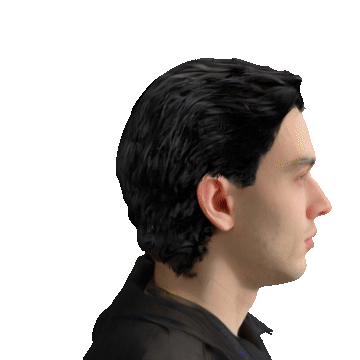

<div align="center">

# ShapeUp

**Real-Time 3D Haircut Experimentation**

[](https://tryshapeup.cc)
[](#quality-checks)
[](#how-it-works)
[](SECURITY.md)

</div>

<p align="center">
  
  
</p>

## Overview

Our pipeline is 2-3x cheaper than traditional "snapshot" methods, avoids the risk of drift across views, and is up to 15x faster with the prebaked pipeline. ShapeUp takes one selfie, reconstructs the person's head as a 3D Gaussian splat, generates candidate hairstyles onto it, and lets them turn the result around in the browser at sub-120 ms latency. 

## How it works

```
      CATALOG PREBAKE
    ┌──────────────────┐     ┌──────────────────┐     ┌──────────────────┐
    │   STYLE PHOTOS   │     │   RECONSTRUCT    │     │  PIXEL-GAUSSIAN  │
    │                  │     │                  │     │       MAP        │
    │   house model    │     │  6 views w/ one  │     │                  │
    │   edited into    │ ──► │   Gaussian per   │ ──► │   Gaussian to    │
    │   every style    │     │      pixel       │     │   (view, row,    │
    │                  │     │                  │     │     column)      │
    └──────────────────┘     └──────────────────┘     └─────────┬────────┘
                                                                ▼
    ┌──────────────────┐     ┌──────────────────┐     ┌──────────────────┐
    │     CLEANUP      │     │ HAIR EXTRACTION  │     │ 2D SEGMENTATION  │
    │                  │     │                  │     │                  │
    │ clean ghost-face │     │    keep hair     │     │ SegFormer label  │
    │ and stray clumps │ ◄── │  Gaussians and   │ ◄── │     map over     │
    │                  │     │     quantize     │     │    Gaussians     │
    │                  │     │                  │     │                  │
    └─────────┬────────┘     └──────────────────┘     └──────────────────┘
              ▼
    ┌────────────────────────────────────────────────────────────────────┐
 ┌──┤  CATALOG             hair-only splats                              │
 │  └────────────────────────────────────────────────────────────────────┘
 │
 │    LIVE                per selfie, in the app
 │  ┌────────────────────────────────────────────────────────────────────┐
 │  │  CAPTURE             selfie upload / live scan                     │
 │  └─────────────────────────────────┬──────────────────────────────────┘
 │                                    ▼
 │  ┌────────────────────────────────────────────────────────────────────┐
 │  │  RECONSTRUCT         Gaussian-splat head on a GPU                  │
 │  └─────────────────────────────────┬──────────────────────────────────┘
 │                                    ▼
 │  ┌────────────────────────────────────────────────────────────────────┐
 │  │  TRY-ON BASE         close-cropped copy of the head                │
 │  └─────────────────────────────────┬──────────────────────────────────┘
 │                                    ▼
 │  ┌────────────────────────────────────────────────────────────────────┐
 └─►│  ALIGN AND MERGE     catalog hair fitted to your head              │
    └────────────────────────────────────────────────────────────────────┘
```

Our pipeline leverages Weijie Lyu's Facelift for 3D reconstruction, with Google Image Generation 3.1 between edits to prepare valid blueprints equipped with necessary constraints for hair type and style. Manually, this takes ~18 seconds from request to reconstruction: ten seconds image generation, eight seconds 3D reconstruction. With our dynamic extraction, clean-up, and alignment pipelines, **we bring this down to less than 120 ms**.

On our deployed website (https://tryshapeup.cc), we require a Biometric Agreement so we can legally process a selfie and render it. We collect scans, but only for debugging purposes - these scans are automatically deleted if you were to revoke the Biometric Agreement. Lastly, for user convenience, we handle all inference free-of-charge, at the courtesy of AWS/Modal. 

We have uploaded this repository to share the process for anyone who isn't comfortable with data being collected but would love to experiment. Enjoy!

## Installation

```sh
npm install
touch .env.local             # Clerk, Convex, S3, Stripe, Gemini keys and FACELIFT_URL
```

Convex functions live in `convex/`; read `convex/_generated/ai/guidelines.md` before editing them.

## Quick start

```sh
npm run dev                  # http://localhost:3000
npm run facelift             # show or switch the reconstruction upstream (auto | oscar | modal)
```

## Quality checks

```sh
npm run typecheck && npm run lint && npm test   # definition of done
npm run test:e2e                                # Playwright flows
```

Current state on `main`: typecheck clean, 39 Vitest files with 313 tests passing, 4 Playwright specs.

## Limitations

- If cloned, reconstruction requires an external GPU worker and its shared secret - without them the studio cannot create scans.
- Splat quality follows the input photo. Hats, heavy occlusion, and low light degrade the head model.
- Biometric data handling is described in [COMPLIANCE_NOTES.md](COMPLIANCE_NOTES.md); report issues per [SECURITY.md](SECURITY.md).

## Repository

| Path | Contents |
|---|---|
| `src/app/` | App Router pages: studio, dashboard, barber flow, pricing, admin, API routes |
| `src/components/` | Viewer, capture, booking, dialogs, with colocated tests |
| `convex/` | Backend functions, accounts, tokens, refunds |
| `server/` | GPU workers: reconstruction deployments, PLY editing experiments |
| `scripts/` | Upstream switcher, S3 CORS, preview baking, catalog prebake pipeline (`scripts/prebake-pipeline/`) |
| `e2e/`, `test/` | Playwright specs and shared fixtures |

## Acknowledgements

Single-image head reconstruction builds on [FaceLift](https://github.com/weijielyu/FaceLift). Rendering uses [three.js](https://threejs.org) and [react-three-fiber](https://github.com/pmndrs/react-three-fiber); the stack is [Next.js](https://nextjs.org), [Convex](https://convex.dev), [Clerk](https://clerk.com). ShapeUp was first built at HackPrinceton as `shapeup-hackprinceton`.
